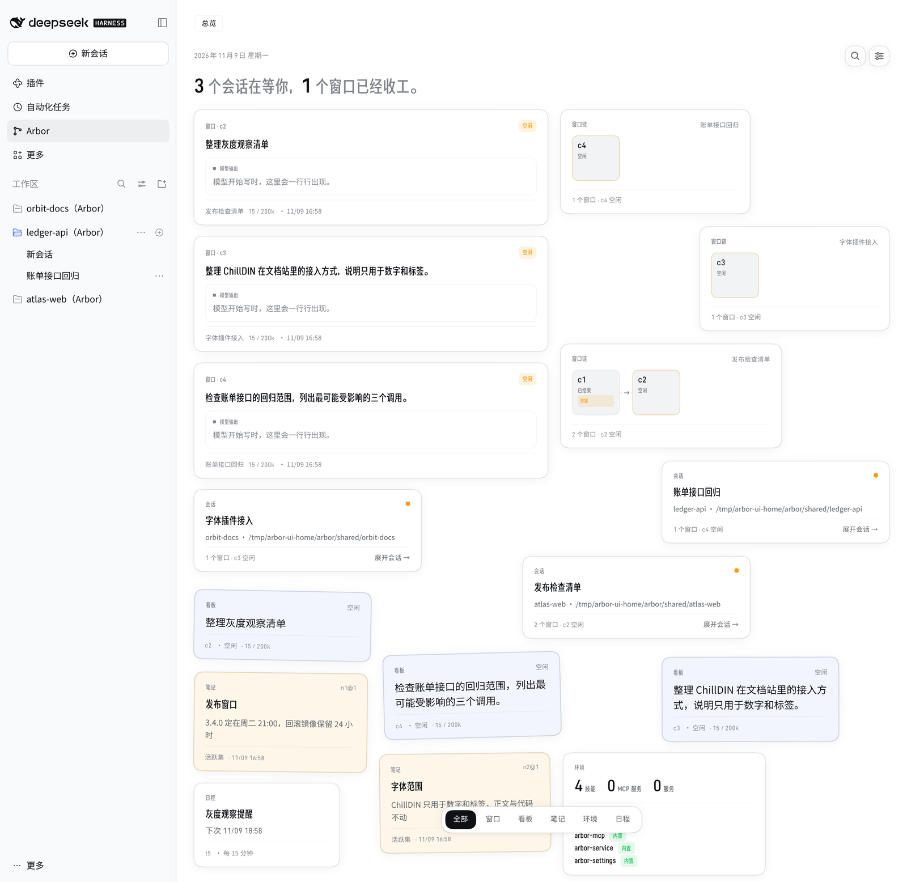
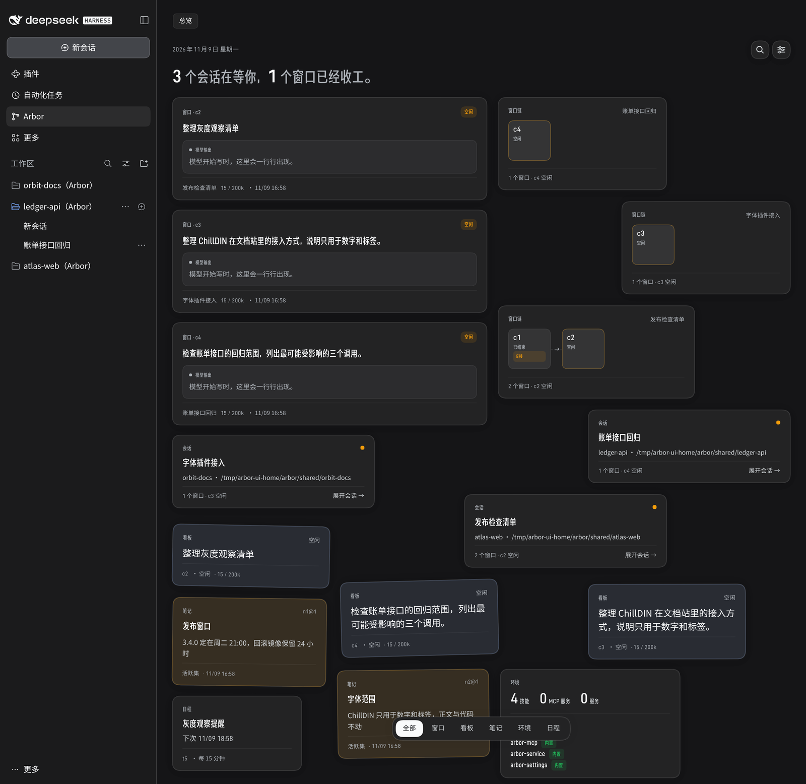
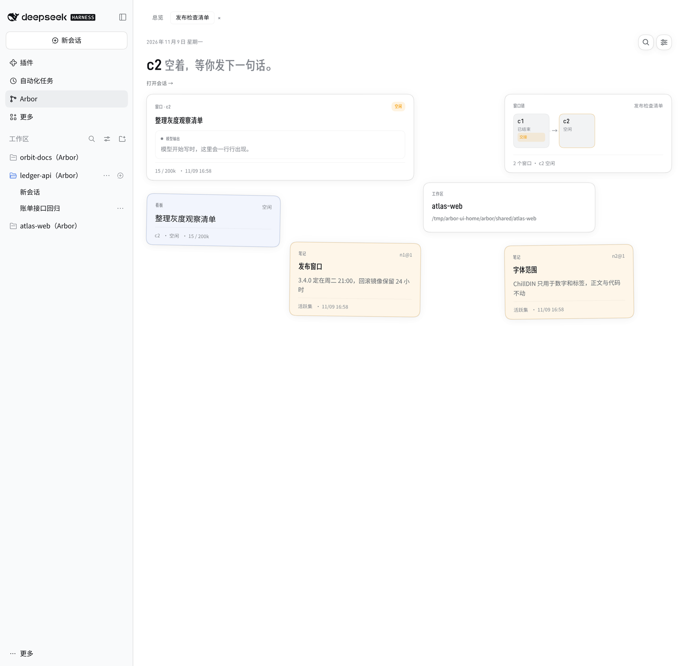
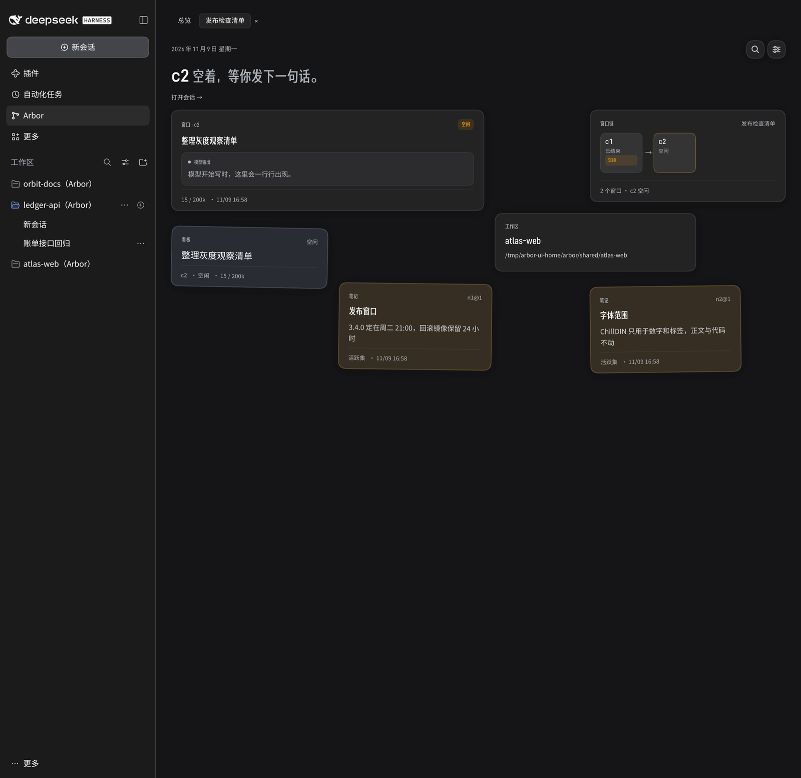

# dsh-arbor

Run [arbor](https://github.com/4fuu/arbor) as the agent driver inside
[DeepSeek Harness](https://github.com/deepseek-ai/deepseek-harness) (DSH).

DSH gives a user a session, a transcript, approvals, plugins, skills and a model
picker. arbor gives an agent disposable context windows over one shared journal,
note store and workspace, instead of one long conversation. dsh-arbor connects
them: one arbor host runs inside the DSH process, each DSH session that selects
**Arbor** is served by that host, and the window's reply is written back to the
DSH session as an ordinary assistant message. A DSH session that does not select
Arbor keeps running on DSH's own embedded AgentLoop, in the same process.

> **Status.** This is a research-grade integration, not a DSH release. It is
> pinned to one DSH version and relies on DSH internals. Read
> [Versions and compatibility](docs/versions.md) before installing it on
> anything you care about. The bundle is not published to npm; installing means
> checking out this repository.

## What an arbor session changes

Choosing **Arbor** in a DSH composer creates the session under the `arbor` agent
preset. That session then runs on arbor, and the following are true for it:

- **One window per turn, one chain per session.** A DSH session is one arbor
  conversation: its first turn opens a window, a window that ends hands off to a
  continuation, and the next turn drives the chain. The journal and note store
  live under `$DSH_HOME/arbor/` and survive a restart.
- **arbor's workspace, not DSH's sandbox.** A window works in arbor's shared
  folder (`$DSH_HOME/arbor/shared`). When the `ovnfs` binary is available a
  window opens a copy-on-write checkout and merges back with `apply`; otherwise
  arbor uses a plain directory. **There is no DSH sandbox for an arbor session:**
  arbor's file tools and commands run on the host, and arbor's own secret scrub
  is the only protection on what reaches the model.
- **arbor's projects.** The shared folder's project folders are the DSH project
  list for arbor composers. A directory the user adds outside the shared folder
  is recorded as an external pointer for that session and used in place.
- **arbor's prompt and tools.** DSH's official prompt sections are decided one by
  one; the ones arbor replaces are absent, third-party sections go into a
  `<dsh>` data block, and a trusted `<harness>` section says what remains true of
  DSH. DSH tools are offered to the model as arbor external tools, and arbor's
  own tools replace DSH tools with the same capability.
- **The Arbor page.** A permanent **Arbor** entry in DSH's left navigation opens
  the whole-host overview and one tab per arbor session: windows, chains,
  handoffs, projects, the board, notes, `/env`, schedules and arbor's search.
  An arbor composer hides DSH's sandbox access-mode switch, because that switch
  does not apply to it.

## What stays untouched in ordinary DSH sessions

A session that does not select Arbor is an ordinary DSH session. It keeps:

- DSH's embedded AgentLoop, session format, turn boundaries and streaming path;
- DSH's sandbox policy and its `ctx.fs` / `ctx.shell` file and command tools;
- DSH's project management, working directory and prompt assembly;
- its composer, sandbox access-mode switch, header and sidebar behavior.

It gets **no Arbor tab** and no arbor windows. The only shared surface is the
permanent Arbor entry in the left navigation, which simply does not list that
session. The routing registry replaces DSH's base `agent` row so it can send
`agentPreset: 'arbor'` sessions to arbor; every other session goes to the
official loop. Approvals still use DSH's approval path for both kinds of
session, and arbor's windows are registered so DSH's sidebar leaves them out.

## Screenshots

| Overview, light | Overview, dark |
| --- | --- |
|  |  |
| **Session tab, light** | **Session tab, dark** |
|  |  |

These are the web profile at 1440 px wide with the optional
[font plugin](https://github.com/4fuu/dsh-arbor-fonts) installed: ChillDIN
Gothic for labels and ChillDIN for numerals, while body text and code keep
DSH's fonts. The same overview without the plugin is
[here](docs/screenshots/overview-without-fonts.png).

## Install

Requirements: Node.js 24.9 or newer, pnpm 11.28.5, and a checkout of this
repository. The sources are TypeScript run through Node's type stripping, so
there is no build step. The default proof run needs no API key and no network.

```bash
git clone https://github.com/4fuu/dsh-arbor
cd dsh-arbor
pnpm install --frozen-lockfile
pnpm check                 # tsc --noEmit over every package and proof
pnpm proofs                # 29 proofs against the scripted model
```

The first install may ask pnpm to approve dependency build scripts. Do not
approve them by hand: the repository's `pnpm-workspace.yaml` already denies the
six scripts it pulls in, each with the reason, and `pnpm install` finishes
cleanly with that policy.

### Hand the install to a model

[docs/install-for-agents.md](docs/install-for-agents.md) is a step-by-step guide
written for an AI agent: clone, install, check, run the proofs, drive a live turn
with a restart, boot the web profile, and inspect what ran. Give a model this
prompt, editing the bracketed parts or dropping them:

```text copy Copy Install Prompt
Install dsh-arbor (https://github.com/4fuu/dsh-arbor) in this environment [in a
scratch clone under /tmp] and show me that it works: follow
docs/install-for-agents.md, run pnpm install --frozen-lockfile, pnpm check and
pnpm proofs, and [also drive one live turn against the real DeepSeek model, with
a DSH restart and resume in the middle]. Report which proofs passed, what the
live turn answered, and anything that did not work. Fix only what is yours to
fix and tell me what you changed.
```

## Use it in DSH

The proofs boot a profile and drive sessions directly. To use the browser
surface, boot DSH's `web` profile with this repository's bundle mounted, or
follow [section 7 of the install guide](docs/install-for-agents.md#7-wiring-the-bundle-into-a-real-dsh-installation)
to wire the bundle into a real `$DSH_HOME/profiles/<name>`. Then pick **Arbor**
in a composer and send a message. The session is created under the preset; its
window and chain appear under the **Arbor** entry, and an ordinary session
started beside it keeps DSH's own composer and sandbox behavior.

The one-shot `dsh <task>` runner cannot drive an arbor-preset session: DSH's
runner refuses to adopt a session that runs under a preset. Use the web client,
the SDK path the proofs use, or a remote `agent-preset/select` on a blank.

## Pinned DSH version

DSH is pinned to **`dsh-v0.2.2-rc.1`** (npm
`@deepseek-ai/dsh@0.2.2-rc.1`, commit `66491b05e3` of
`deepseek-ai/deepseek-harness`). Every `@deepseek-ai/dsh*` dependency is an
exact version, every package under `packages/` declares
`engines.dsh: 0.2.2-rc.1`, and `pnpm check:pin` checks both plus the prompt
bridge's `DSH_PINNED_VERSION`.

A different DSH version is unsupported. The bundle depends on DSH's row names,
its one-`AgentFactory` rule, its prompt-section registry, its client slot
registration and its exact Fetch registry; a move in any of them can fail the
boot, leave an official prompt section undecided, or stop the Arbor page from
registering. `proofs/12-official-sections.ts` and `proofs/18-picker-pin.ts`
are the behavioral checks. The canonical pin and the upgrade procedure are in
[Versions and compatibility](docs/versions.md).

## Optional: the font plugin

[dsh-arbor-fonts](https://github.com/4fuu/dsh-arbor-fonts) is a separate DSH
client plugin that changes only the typography of the Arbor page. It sets
ChillDIN Gothic for display labels and ChillDIN for numerals, leaves body text
and code on DSH's fonts, and does nothing on ordinary pages. It is optional and
must be installed into the same DSH profile as this bundle. The fonts are
licensed under the SIL Open Font License 1.1; the plugin ships the license text,
per-file hashes and attribution.

## Limits worth knowing

- The judge is off: a model-based judge cannot run through the DSH backend yet.
- The bundle is not published to npm. A publication also needs versions for the
  workspace packages and the `workspace:*` dependency specs replaced; see the
  release note in [docs/install-for-agents.md](docs/install-for-agents.md#9-release-notes).
- `ovnfs` is optional. Without it arbor uses the plain-directory workspace, and a
  window no longer gets a copy-on-write checkout.
- The web page's numbers and layout are read from arbor's journal and API; it is
  not a generic DSH dashboard, and it deliberately shows only arbor sessions.
- The prompt bridge, the UI and the picker filter are pinned to DSH's internals,
  not to a stable public API. See [Versions and compatibility](docs/versions.md).

## Documentation

- [Installing and inspecting dsh-arbor](docs/install-for-agents.md) — the
  agent-facing install, proof, live-turn, web-profile and wiring guide.
- [Versions and compatibility](docs/versions.md) — the DSH and arbor pins, and
  what breaks on another DSH version.
- [B0 findings](docs/b0-findings.md), [B3 findings](docs/b3-findings.md) and
  [B3b projects and sandbox](docs/b3b-projects-and-sandbox.md) — historical
  records of the integration's decisions, with the DSH source locations each
  one rests on. They describe earlier stages; the install guide is the current
  status.
- [Layout and proofs](#layout) below for a quick map of the packages.

## Layout

```text
packages/
  arbor-host/       one Arbor host per process: SQLite journal and notes,
                    settings, window lifecycle, workspace and environment
  arbor-driver/     the routing AgentRegistry, AgentFactory, session agent,
                    inbox and stream mirrors, and the journal relay
  arbor-llm/        the arbor AgentBackend over DSH's ctx.llm and ctx.tools
  arbor-prompt/     <harness>, the <dsh> data block, and the section table
  arbor-tools/      DSH tools as arbor external tools, same-name replacement
  arbor-workspace/  arbor's workspace over the shared folder (ovnfs or dir)
  arbor-env/        /env, with DSH's skills and MCP servers mounted read-only
  arbor-bundle/     the installable patch that mounts the rows and UI
  arbor-facts/      the read face behind the Arbor page and its Fetch routes
  arbor-ui/         the Arbor page, session tabs, copy and composer gate
  arbor-ui-workspace/
                    the per-preset hero project picker
  arbor-preset/     the agent-preset row that puts Arbor in the roster
  arbor-testkit/    the boot harness, memory journal and scripted model
patches/            overlay layers a proof applies above the shipped profile
proofs/             one runnable proof per integration point
docs/               install, versions, screenshots and historical findings
scripts/            the DSH pin check
```

## License

MIT. See [LICENSE](LICENSE). The optional font plugin vendors fonts under the
SIL Open Font License 1.1; its repository carries the license text and
attribution.
